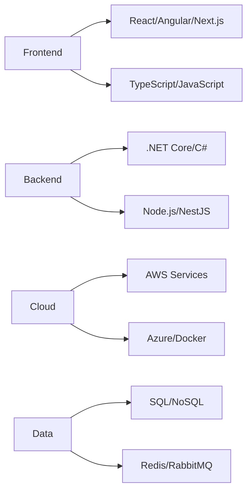

<div align="center">

<!-- Hero Section with Professional Branding -->


# 👋 Hi, I'm Juan "JC" Gómez

### Senior Software Engineer | Full-Stack Architect | Legacy Modernization Expert

<p>
  <a href="https://www.linkedin.com/in/jcgomez89/"></a>
  <a href="mailto:gb.jc@outlook.com"></a>
  <a href="https://github.com/Juxn89"></a>
</p>


</div>

---

## 🎯 About Me

**Senior Full-Stack Engineer** with **15+ years** of proven experience modernizing legacy systems and building scalable solutions for multinational companies. Specialized in delivering **high-availability systems (>99.9%)** and driving **significant performance improvements (+35%)** in mission-critical applications.

```typescript
const juanProfile = {
  currentRole: "Software Engineer @ The Stepstone Group",
  location: "Nicaragua 🌎 (Remote-first)",
  expertise: ["Legacy Modernization", "Full-Stack Architecture", "Cloud Infrastructure"],
  impact: {
    availability: ">99.9%",
    performanceGains: "+35%",
    deploymentReduction: "~25%",
    reachScale: "Millions of users across 6 international brands"
  },
  openTo: ["Senior/Staff Engineer roles", "Remote opportunities", "Technical Leadership"]
};
```

### 💡 What I Bring to the Table

<table>
  <tr>
    <td width="50%" valign="top">
      
**🏗️ Technical Leadership**
- Led digital platforms impacting **millions of users** across Europe and Central America
- Proven track record managing **distributed teams** in multinational settings
- Expert in **Agile/CI-CD** workflows and team collaboration

    </td>
    <td width="50%" valign="top">
      
**⚡ Performance & Scalability**
- Achieved **>99.9% system availability** in production environments
- Delivered **+35% performance improvements** through optimization
- Reduced deployment times by **~25%** via automation and microservices

    </td>
  </tr>
  <tr>
    <td width="50%" valign="top">
      
**🔄 Modernization Specialist**
- Successfully migrated **ASP.NET → .NET Core** systems
- Transformed **VB 6.0 legacy applications** to modern stacks
- Implemented **microfrontends & microservices** architectures

    </td>
    <td width="50%" valign="top">
      
**🌐 Full-Stack Versatility**
- **Backend:** .NET Core, C#, Node.js, NestJS, GraphQL
- **Frontend:** React, Angular, Next.js, TypeScript
- **Cloud:** AWS (production), Azure, Docker, Redis, RabbitMQ

    </td>
  </tr>
</table>

---

## 💼 Professional Experience

<details open>
<summary><b>🔹 Software Engineer @ The Stepstone Group</b> <i>(Jan 2022 - Present)</i> | 🇬🇧 United Kingdom</summary>
<br/>

**Digital recruitment platforms across 6 international brands** serving Europe, Central America, and the Caribbean

**Key Achievements:**
- 🚀 Architected and implemented **microfrontends, microservices, and messaging queues** improving scalability
- ⚡ Reduced deployment times by **~25%** through automation and CI/CD optimization
- 🎨 Enhanced UX and redesigned multiple brand interfaces, receiving **positive user feedback**
- 🐛 Resolved critical bugs and delivered **business-driven features** aligned with pricing strategy
- ☁️ Ensured **high availability and performance** of services on AWS infrastructure

**Tech Stack:** React, .NET Core, AWS, Microservices, Message Queues, CI/CD

</details>

<details>
<summary><b>🔹 .NET Developer @ Axxis-Systems</b> <i>(Jun 2020 - Dec 2021)</i> | 🇳🇮 Nicaragua</summary>
<br/>

**Core insurance platforms** for clients across Latin America and Europe

**Key Achievements:**
- 📈 Improved operational efficiency by **~15%** through automation and system enhancements
- ⚡ Enhanced platform usability and reduced load times by **~20%** using ExtJS optimizations
- 🧮 Designed complex calculations for insurance policies handling large datasets and business rules
- 🛠️ Delivered bug fixes and business-critical features ensuring system reliability

**Tech Stack:** .NET, ExtJS, JavaScript, SQL Server, Insurance Domain

</details>

<details>
<summary><b>🔹 Team Leader @ INIFOM</b> | 🇳🇮 Nicaragua</summary>
<br/>

**Software solutions for all 153 municipalities** across Nicaragua supporting public sector operations

**Key Achievements:**
- 🔧 Led implementation of **Team Foundation Server (TFS)** improving collaboration and code management
- 🚀 Migrated legacy **ASP.NET applications to .NET Core** enhancing performance and security
- 🖥️ Managed servers and infrastructure: IIS, SQL Server, Reporting Services, TFS administration
- 🛡️ Provided ongoing support for **VB 6.0 legacy systems** ensuring business continuity

**Tech Stack:** .NET Core, ASP.NET, VB 6.0, SQL Server, TFS, IIS

</details>

<details>
<summary><b>🔹 Software Developer @ Attorney General's Office</b> <i>(Mar 2014 - Apr 2017)</i> | 🇳🇮 Nicaragua / 🇵🇦 Panama</summary>
<br/>

**National cadastre system** for 153 municipal governments

**Key Achievements:**
- 🏛️ Led development of **nationwide cadastre system (SISCAT)** enabling efficient territorial management
- 🔗 Integrated municipal and physical cadastre systems **(SISCAT + SISCAF)** for centralized administration
- 💰 Coordinated **taxpayer data migration** to financial systems improving municipal revenue collection

**Tech Stack:** .NET, SQL Server, GIS Systems, Government/Public Sector

</details>

<details>
<summary><b>🔹 Web & .NET Developer @ Managua's Town Hall</b> <i>(Jan 2010 - Mar 2014)</i> | 🇳🇮 Nicaragua</summary>
<br/>

**Strategic planning and project management systems** for municipal government

**Key Achievements:**
- 📋 Developed **Strategic Planning System** using ASP MVC for centralized plan management
- 🚀 Created **Project Formulation System** streamlining project creation and monitoring
- 🔄 Migrated desktop application to **web-based platform** enhancing accessibility and collaboration

**Tech Stack:** ASP.NET MVC, C#, SQL Server, Web Development

</details>

---

## 🛠️ Technical Skills

### Core Technologies

<div align="center">

| **Backend** | **Frontend** | **Cloud & DevOps** | **Databases** |
|:---:|:---:|:---:|:---:|
|  |  |  |  |
|  |  |  |  |
|  |  |  |  |
|  |  |  |  |
|  |  |  | |

</div>

### Full Stack Ecosystem



### 🎖️ Specializations

- **Software Architecture:** Microservices, Microfrontends, Event-Driven Design, DDD
- **Methodologies:** Agile/Scrum, CI/CD, TDD, Clean Architecture
- **Leadership:** Technical Lead, Team Management, Cross-functional Collaboration
- **Languages:** Spanish (Native), English (B1)

---

## 🚀 Featured Open-Source Projects

<table>
  <tr>
    <td width="50%" valign="top">
      <h3><a href="https://github.com/Juxn89/net-core-microservice">🔹 .NET Core Microservice Architecture</a></h3>
      <p>Production-ready microservice architecture demonstrating event-driven design</p>
      <p><strong>Stack:</strong> .NET Core • RabbitMQ • MongoDB • Docker</p>
      
    </td>
    <td width="50%" valign="top">
      <h3><a href="https://github.com/Juxn89/nestjs-graphql-devtalles">🔹 NestJS GraphQL API</a></h3>
      <p>Scalable backend starter following DDD and clean architecture principles</p>
      <p><strong>Stack:</strong> NestJS • GraphQL • TypeORM • PostgreSQL</p>
      
    </td>
  </tr>
  <tr>
    <td width="50%" valign="top">
      <h3><a href="https://github.com/Juxn89/ReactJs-Pro">🔹 ReactJS Pro Components</a></h3>
      <p>Advanced React patterns: Compound Components, Control Props, Extensible Styles</p>
      <p><strong>Stack:</strong> React • TypeScript • Advanced Patterns</p>
      
    </td>
    <td width="50%" valign="top">
      <h3><a href="https://github.com/Juxn89/nodejs-devtalles">🔹 NodeJS REST API</a></h3>
      <p>Modular REST API with authentication, security, and best practices</p>
      <p><strong>Stack:</strong> Node.js • Express • JWT • MongoDB</p>
      
    </td>
  </tr>
</table>

<details>
<summary>📦 <b>View More Projects</b></summary>
<br/>

- **[Covid-19 Cases Tracker](https://github.com/Juxn89/Covid19-Cases)** - Real-time pandemic dashboard with Chart.js and REST API integration
- **[ReactJS Fundamentals](https://github.com/Juxn89/ReactJS)** - Core React concepts with practical examples and best practices

</details>

---

## 📊 GitHub Activity

<div align="center">
  


</div>

---

## 🎓 Education

**🎓 Bachelor's Degree in Software Engineering**  
Central American University (UCA), Nicaragua | 2007 - 2011

---

## 📫 Let's Connect

<div align="center">

I'm open to discussing **Senior/Staff Engineer roles**, **technical leadership opportunities**, and **remote positions** where I can drive impact through modern architectures and proven engineering practices.

<br/>

[](https://www.linkedin.com/in/jcgomez89/)
[](mailto:gb.jc@outlook.com)
[](https://github.com/Juxn89?tab=repositories)

</div>

---

<div align="center">
  
  
  <br/><br/>
  
  <i>💻 Building scalable systems • 🌍 Remote-first mindset • ☕ Powered by coffee and clean code</i>
  
</div>
