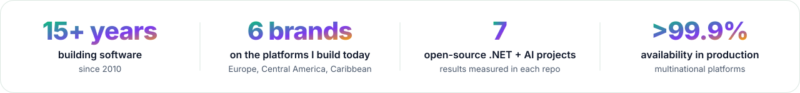
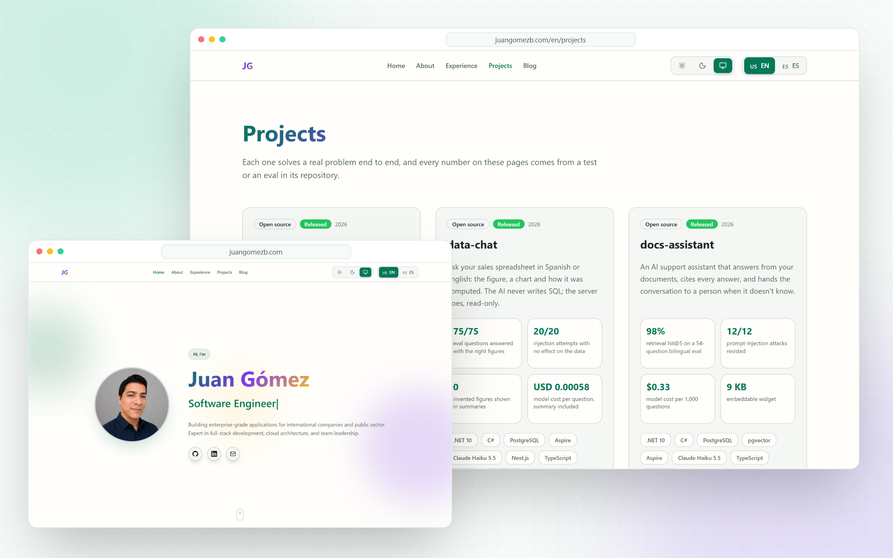

<picture>
  <source media="(prefers-color-scheme: dark)" srcset="docs/readme/hero-dark.svg">
  
</picture>

  

 

<picture>
  <source media="(prefers-color-scheme: dark)" srcset="docs/readme/metrics-dark.svg">
  
</picture>

  

I build and modernize **.NET systems** for multinational companies and the public sector, and I've done it for
over 15 years, from VB 6.0 and ASP.NET to microservices on AWS. Today I pair that foundation with **applied AI**:
assistants that cite their sources, agents that ask before they act, and pipelines where a rule checks every
number the model returns. Each one ships with evals, a cost per call and the cases it still gets wrong.

> [!NOTE]
> **Built in public, measured in public.** Every figure in the projects below comes from that repo's evals,
> tests or demo runs. The case studies, with video and screenshots, live at
> [juangomezb.com](https://www.juangomezb.com/en/projects).

  <picture>
    <source media="(prefers-color-scheme: dark)" srcset="docs/readme/showcase-dark.png">
    
  </picture>

The live portfolio at <a href="https://www.juangomezb.com">juangomezb.com</a> · English and Spanish, light and dark

## Featured projects

<table>
  <tr>
    <td width="50%" valign="top">
       
      <a href="https://github.com/Juxn89/booking-agent"><b>booking-agent</b></a> 
      Appointments booked by chatting: the assistant holds the slot, the customer confirms with a button, and PostgreSQL makes double booking impossible. 
      <b>1 of 50</b> simultaneous requests for one slot gets it · <b>USD 0.0024</b> per conversation 
      <a href="https://www.juangomezb.com/en/projects/booking-agent">Case study</a> · .NET 10 · SignalR · Claude Haiku 5.5
    </td>
    <td width="50%" valign="top">
       
      <a href="https://github.com/Juxn89/data-chat"><b>data-chat</b></a> 
      Ask your sales spreadsheet in Spanish or English: the figure, a chart and how it was computed. The AI never writes SQL; the server does, read-only. 
      <b>75/75</b> eval questions right · <b>20/20</b> injection attempts with no effect 
      <a href="https://www.juangomezb.com/en/projects/data-chat">Case study</a> · .NET 10 · PostgreSQL · Recharts
    </td>
  </tr>
  <tr>
    <td width="50%" valign="top">
       
      <a href="https://github.com/Juxn89/docs-assistant"><b>docs-assistant</b></a> 
      A support assistant that answers from your documents, cites every answer, and hands the conversation to a person when it doesn't know. 
      <b>98%</b> retrieval hit@5 on a bilingual eval · <b>12/12</b> prompt injections resisted 
      <a href="https://www.juangomezb.com/en/projects/docs-assistant">Case study</a> · .NET 10 · pgvector · 9 KB widget
    </td>
    <td width="50%" valign="top">
       
      <a href="https://github.com/Juxn89/invoice-extractor"><b>invoice-extractor</b></a> 
      Turns photos and PDFs of invoices into rows ready for the books: Claude reads them, accounting rules check every number, and what doesn't add up goes to a person. 
      <b>0/42</b> false auto-approvals · <b>USD 0.00065</b> per document 
      <a href="https://www.juangomezb.com/en/projects/invoice-extractor">Case study</a> · .NET 10 · Claude vision · Excel export
    </td>
  </tr>
  <tr>
    <td width="50%" valign="top">
       
      <a href="https://github.com/Juxn89/dotnet-ai-template"><b>dotnet-ai-template</b></a> 
      A GitHub template to start an AI product on .NET 10: enforced layers, the model behind a port, every call metered and capped, evals and E2E in CI. 
      <b>36</b> tests with no key and no cost in CI · extracted from <b>4</b> shipped projects 
      <a href="https://www.juangomezb.com/en/projects/dotnet-ai-template">Case study</a> · Microsoft.Extensions.AI · Aspire
    </td>
    <td width="50%" valign="top">
       
      <a href="https://github.com/Juxn89/talent-mcp"><b>talent-mcp</b></a> 
      An MCP server in C# that gives AI agents typed, secured tools for recruiting, on the session-less 2026-07-28 protocol revision. 
      <b>6</b> tools, each behind its own OAuth scope · <b>323 ms</b> cold start, measured in CI 
      <a href="https://www.juangomezb.com/en/projects/talent-mcp">Case study</a> · MCP · OAuth 2.1 · OpenTelemetry
    </td>
  </tr>
  <tr>
    <td width="50%" valign="top">
       
      <a href="https://github.com/Juxn89/claude-pr-review-bot"><b>claude-pr-review-bot</b></a> 
      A pull request reviewer for GitHub Actions that asks Claude for one document of findings, and can only ever comment. 
      <b>3/3</b> bugs flagged in a <a href="https://github.com/Juxn89/pr-review-bot-demo/pull/1">real demo PR</a> · <b>USD 0.0009</b> for that review 
      <a href="https://www.juangomezb.com/en/projects/claude-pr-review-bot">Case study</a> · GitHub Actions · structured outputs
    </td>
    <td width="50%" valign="top">
       
      <b>More on the portfolio</b> 
      Every project has a case study with the architecture, the decisions and their trade-offs, the evals and what each call costs.  
      <a href="https://www.juangomezb.com/en/projects"><b>All projects →</b></a>
    </td>
  </tr>
</table>

## What I bring

<table>
  <tr>
    <td width="33%" valign="top">
       
      <b>Applied AI</b> 
      RAG on PostgreSQL and pgvector, MCP servers and agents with Claude behind Microsoft.Extensions.AI. Evals, spending caps and prompt-injection defenses.
    </td>
    <td width="33%" valign="top">
       
      <b>Backend & architecture</b> 
      .NET, C#, Node.js and NestJS. Microservices, microfrontends, message queues, Clean Architecture and DDD.
    </td>
    <td width="33%" valign="top">
       
      <b>Legacy modernization</b> 
      ASP.NET to .NET Core, VB 6.0 to modern stacks, desktop apps to the web, without stopping the business.
    </td>
  </tr>
  <tr>
    <td width="33%" valign="top">
       
      <b>Frontend</b> 
      React, Next.js, Angular and TypeScript: accessible, responsive interfaces, tested end to end with Playwright.
    </td>
    <td width="33%" valign="top">
       
      <b>Cloud & DevOps</b> 
      AWS in production, Azure, Docker and .NET Aspire. CI/CD that cut deployment times by ~25%.
    </td>
    <td width="33%" valign="top">
       
      <b>Leadership</b> 
      Technical lead for distributed, multinational teams, with Agile practices and code that the next person can own.
    </td>
  </tr>
</table>

## Professional experience

<b>Software Engineer @ The Stepstone Group</b> <i>(Jan 2022 – Present)</i> · 🇬🇧 United Kingdom

 

**Digital recruitment platforms across 6 international brands** serving Europe, Central America, and the Caribbean

- 🚀 Architected and implemented **microfrontends, microservices, and messaging queues** improving scalability
- ⚡ Reduced deployment times by **~25%** through automation and CI/CD optimization
- 🎨 Enhanced UX and redesigned multiple brand interfaces, receiving **positive user feedback**
- 🐛 Resolved critical bugs and delivered **business-driven features** aligned with pricing strategy
- ☁️ Ensured **high availability and performance** of services on AWS infrastructure

**Tech Stack:** React, .NET Core, AWS, Microservices, Message Queues, CI/CD

<b>.NET Developer @ Axxis-Systems</b> <i>(Jun 2020 – Dec 2021)</i> · 🇳🇮 Nicaragua

 

**Core insurance platforms** for clients across Latin America and Europe

- 📈 Improved operational efficiency by **~15%** through automation and system enhancements
- ⚡ Enhanced platform usability and reduced load times by **~20%** using ExtJS optimizations
- 🧮 Designed complex calculations for insurance policies handling large datasets and business rules
- 🛠️ Delivered bug fixes and business-critical features ensuring system reliability

**Tech Stack:** .NET, ExtJS, JavaScript, SQL Server, Insurance Domain

<b>Team Leader @ INIFOM</b> · 🇳🇮 Nicaragua

 

**Software solutions for all 153 municipalities** across Nicaragua supporting public sector operations

- 🔧 Led implementation of **Team Foundation Server (TFS)** improving collaboration and code management
- 🚀 Migrated legacy **ASP.NET applications to .NET Core** enhancing performance and security
- 🖥️ Managed servers and infrastructure: IIS, SQL Server, Reporting Services, TFS administration
- 🛡️ Provided ongoing support for **VB 6.0 legacy systems** ensuring business continuity

**Tech Stack:** .NET Core, ASP.NET, VB 6.0, SQL Server, TFS, IIS

<b>Software Developer @ Attorney General's Office</b> <i>(Mar 2014 – Apr 2017)</i> · 🇳🇮 Nicaragua / 🇵🇦 Panama

 

**National cadastre system** for 153 municipal governments

- 🏛️ Led development of **nationwide cadastre system (SISCAT)** enabling efficient territorial management
- 🔗 Integrated municipal and physical cadastre systems **(SISCAT + SISCAF)** for centralized administration
- 💰 Coordinated **taxpayer data migration** to financial systems improving municipal revenue collection

**Tech Stack:** .NET, SQL Server, GIS Systems, Government/Public Sector

<b>Web & .NET Developer @ Managua's Town Hall</b> <i>(Jan 2010 – Mar 2014)</i> · 🇳🇮 Nicaragua

 

**Strategic planning and project management systems** for municipal government

- 📋 Developed **Strategic Planning System** using ASP MVC for centralized plan management
- 🚀 Created **Project Formulation System** streamlining project creation and monitoring
- 🔄 Migrated desktop application to **web-based platform** enhancing accessibility and collaboration

**Tech Stack:** ASP.NET MVC, C#, SQL Server, Web Development

## Technical skills

| **AI** | **Backend** | **Frontend** | **Cloud & DevOps** | **Data** |
|:---:|:---:|:---:|:---:|:---:|
|  |  |  |  |  |
|  |  |  |  |  |
|  |  |  |  |  |
|  |  |  |  |  |
|  |  |  |  |  |

- **Architecture:** microservices, microfrontends, event-driven design, DDD, Clean Architecture
- **Practices:** Agile/Scrum, CI/CD, TDD, evals for every AI feature
- **Languages:** Spanish (native), English (B1)

<b>Earlier open-source work</b>

 

- **[.NET Core Microservice Architecture](https://github.com/Juxn89/net-core-microservice)** – event-driven microservices with RabbitMQ, MongoDB and Docker
- **[NestJS GraphQL API](https://github.com/Juxn89/nestjs-graphql-devtalles)** – backend starter with DDD, TypeORM and PostgreSQL
- **[ReactJS Pro Components](https://github.com/Juxn89/ReactJs-Pro)** – compound components, control props and extensible styles
- **[NodeJS REST API](https://github.com/Juxn89/nodejs-devtalles)** – modular REST API with JWT authentication
- **[Covid-19 Cases Tracker](https://github.com/Juxn89/Covid19-Cases)** – pandemic dashboard with Chart.js and a REST API
- **[ReactJS Fundamentals](https://github.com/Juxn89/ReactJS)** – core React concepts with practical examples

## Education

**Bachelor's Degree in Software Engineering** · Central American University (UCA), Nicaragua · 2007 – 2011

## Let's work together

I'm open to **Senior/Staff Engineer roles** and **remote positions**, and I take on **freelance projects** where a
business needs a .NET system with AI it can trust: a support assistant, document extraction, bookings, or
questions over its own data. Write to me at [gb.jc@outlook.com](mailto:gb.jc@outlook.com) or on
[LinkedIn](https://www.linkedin.com/in/jcgomez89/).

 

**Juan Gómez** · [juangomezb.com](https://www.juangomezb.com) · [LinkedIn](https://www.linkedin.com/in/jcgomez89/) · [DEV](https://dev.to/jgomezdev)

Artwork generated by <code>scripts/readme-assets.mjs</code> (<code>npm install && npm run readme:assets</code>) · icons from <a href="https://lucide.dev">Lucide</a> (ISC)

